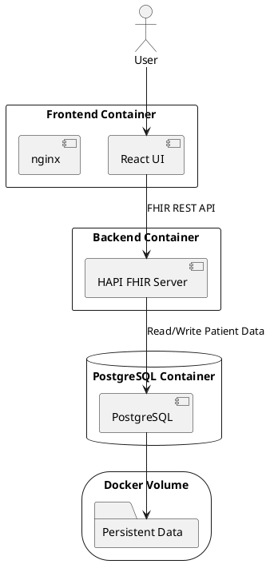

# OH EHR Viewer Architecture

## Overview

OH EHR Viewer is a full-stack healthcare application that simulates a patient clinical viewer.

The application consists of:

- React Frontend
- HAPI FHIR Server
- PostgreSQL Database
- Docker Compose Infrastructure

The frontend communicates with the backend using FHIR REST API requests.

The backend stores and retrieves patient data from PostgreSQL.

Database files are persisted using a Docker Volume.


## System Diagram


## Components

### React 

Purpose: 
User interface. 

Responsibilities:
- Authentication
- Patient Search 
- Dashboard Navigation
- Displaying OLIS Data
- Displaying DICS Data
- Displaying PCR Data

--- 

### nginx 

Purpose: 
Serve React files to the browser. 

Responsibilities:
- Deliver index.html
- Deliver JavaScript bundles
- Deliver CSS
- Handle React Router routing 

--- 

### HAPI FHIR 

Purpose: 
FHIR REST API implementation. 

Responsibilities:
- Handle Patient resources
- Handle Observation resources
- Handle ImagingStudy resources
- Process FHIR searches
- Validate FHIR resources 

--- 

### PostgreSQL 
Purpose: 
Store application data. 

Responsibilities:
- Store Patient records
- Store Observation records
- Store ImagingStudy records
- Return requested data to HAPI 

--- 

### Docker Volume 
Purpose: 
Persistent storage. 

Responsibilities:
- Store PostgreSQL database files
- Preserve patient data after container restarts


## Data Flow

Patient Search Example

User enters Health Card Number

↓

React sends FHIR request

↓

HAPI FHIR receives request

↓

PostgreSQL retrieves matching patient

↓

HAPI returns FHIR response

↓

React displays patient information


## Local Startup

Start all services:

```bash
docker compose up --build

```
Frontend: http://localhost:3000

FHIR Metadata Endpoint: http://localhost:8080/fhir/metadata